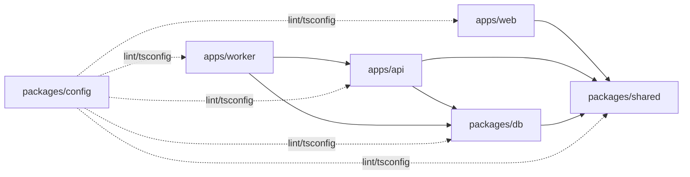
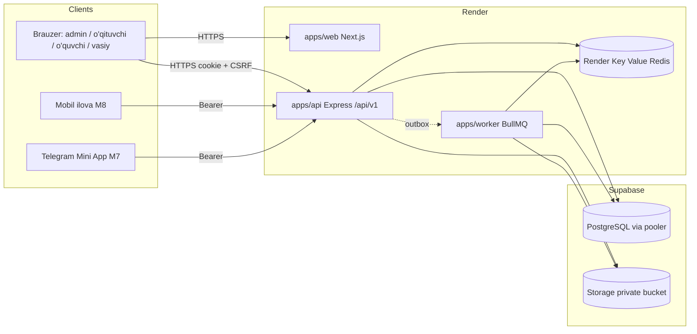
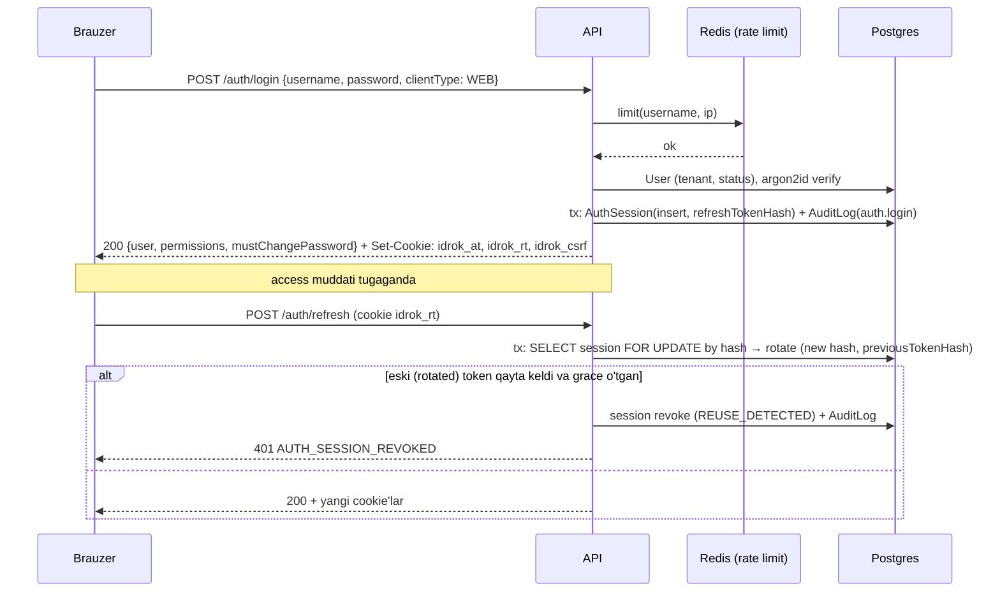

# Idrok System — Arxitektura (M0)

> Holat: tasdiqlash uchun qoralama. Qarorlar `CLAUDE.md` §1 jadvaliga tayanadi; bu yerda ular aniqlashtiriladi.
> Bog'liq hujjatlar: `data-model.md`, `api-plan.md`, `ui-structure.md`, `implementation-plan.md`, `open-questions.md`.

## 1. Tamoyillar

1. **Server — yagona haqiqat manbai.** Hisob-kitob, limit, vaqt, ruxsat, test taymeri — faqat backendda. Klient ko'rsatadi va so'rov yuboradi.
2. **Sof domen qatlami.** Formula va agregatsiyalar DB'siz sof funksiyalar; ular spec'dagi acceptance misollari bilan unit-test qilinadi.
3. **Ledger + snapshot.** Ball va coin — append-only. Yopilgan davr natijasi — o'zgarmas snapshot.
4. **Tenant-scoped hamma narsa.** `tenantId` faqat auth kontekstidan; Prisma darajasida majburlanadi.
5. **Kichik, ishlaydigan qadamlar.** Har qadam — alohida PR, CI yashil.

## 2. Monorepo

pnpm workspaces + Turborepo. Paket nomlari `@idrok/*`.

| Paket | Vazifa | Kimga bog'liq |
|---|---|---|
| `apps/web` | Next.js App Router UI (admin, o'qituvchi, o'quvchi, vasiy). Faqat API orqali ishlaydi, DB'ga ulanmaydi | `shared` |
| `apps/api` | Express REST `/api/v1`, modullar, domen qatlami, repository, infra adapterlar. Worker uchun ham kod manbai | `shared`, `db` |
| `apps/worker` | BullMQ processorlari va scheduler. Yupqa paket: bootstrap + processorlar; servis/domen kodini `@idrok/api` ichki eksportlaridan oladi | `api`, `shared`, `db` |
| `packages/shared` | Zod sxemalar, DTO tiplar, enum'lar, permission ro'yxati, xato kodlari, `time` (sana util), `decimal` (yaxlitlash), `text` (normalizatsiya) | — (izomorf: Node + brauzer) |
| `packages/db` | Prisma schema, migratsiyalar, SQL-only invariantlar, seed, Prisma client fabrikasi + tenant extension | `shared` |
| `packages/config` | ESLint (boundary qoidalari bilan), tsconfig bazalari, Prettier | — |
| `apps/bridge` | (M6) Maktab tarmog'idagi Windows agent: terminal hodisalarini diskka yozib serverga yuboradi, yuz topshiriqlarini ISAPI orqali bajaradi | `hikvision` |
| `packages/hikvision` | (M6) Hikvision ISAPI klienti (Digest), topshiriq bajaruvchi va sinov uchun simulyator. API worker va Bridge birga ishlatadi | — |
| `apps/mobile` | M8 — hozir yaratilmaydi | — |



ESLint boundary qoidalari (`eslint-plugin-boundaries` yoki `import/no-restricted-paths`):
- `apps/web` → `packages/db` va `apps/api` import qila olmaydi.
- `apps/api/src/domain/**` → `@prisma/client`, `express`, `packages/db`, `infra/**` import qila olmaydi (sof qatlam).
- `Date.prototype.getDate|getHours|setHours|getDay|...` va `new Date(<string sana>)` — `packages/shared/time` dan tashqarida taqiqlanadi (`no-restricted-syntax`).
- Tailwind arbitrary rang (`bg-[#...]`, `text-[rgb(...)]`) — taqiqlanadi (`eslint-plugin-tailwindcss` + regex qoida).

## 3. Backend qatlamlari

```
apps/api/src/
  main.ts                    HTTP server bootstrap
  app.ts                     Express app (middleware zanjiri)
  config/                    env (zod bilan validatsiya), feature flaglar
  context/                   AsyncLocalStorage: requestId, tenantId, userId, permissions, locale
  http/                      middleware: requestId, auth, csrf, rateLimit, validate(zod), errorHandler, idempotency
  modules/<name>/
    <name>.routes.ts         marshrut + ruxsat + validatsiya ulash
    <name>.controller.ts     req → DTO → service → res (logic yo'q)
    <name>.service.ts        business logic, transaction chegarasi, audit, outbox
    <name>.repository.ts     Prisma so'rovlari (tenant-scoped client orqali)
    <name>.schemas.ts        zod (shared'dagi DTO'larni qayta eksport/kengaytirish)
    <name>.policy.ts         ma'lumot darajasidagi ruxsat (o'qituvchi faqat o'z guruhi...)
    tests/                   unit (service mock repo bilan) + integration (Supertest + test DB)
  domain/                    SOF funksiyalar: scoring/, lessons/, curriculum/, tests/, coins/
  infra/                     prisma, redis, queue (BullMQ producer), storage, crypto, mailer(yo'q), logger
  jobs/                      job nomlari va payload sxemalari (producer tomoni)
  openapi/                   zod → OpenAPI 3.1 registratsiya, /api/v1/openapi.json
```

**So'rov hayot sikli:** `requestId` → `helmet` → `cors` (ruxsat etilgan originlar env'dan) → `cookieParser` → `auth` (cookie yoki bearer) → `tenantContext` (ALS) → `csrf` (faqat cookie rejimi, unsafe metodlar) → `rateLimit` (Redis) → `validate(zod)` → `requirePermission(code)` → controller → service (`prisma.$transaction`) → `errorHandler`.

**Transaction qoidasi:** service metodi transaction chegarasini belgilaydi; repository'lar `tx` qabul qiladi. AuditLog va OutboxEvent shu `tx` ichida yoziladi.

**Xatolar:** `AppError(code, httpStatus, messageKey, details?)`. Javob: `{ error: { code, message, details? } }`, `message` — tarjima kaliti (`errors.score.limitExceeded`). Kutilmagan xato: `INTERNAL_ERROR`, tafsilot faqat logda (requestId bilan).

**Domen qatlami joyi:** `apps/api/src/domain/*` (frontendga chiqmaydi — "hisob faqat backendda"). Domen kirish/chiqish tiplari va policy config zod sxemasi `packages/shared`da (UI muharriri ham shu sxema bilan forma validatsiyasi qiladi, lekin hisoblamaydi). Asosiy sof modullar:

| Modul | Funksiyalar (misol) | Spec |
|---|---|---|
| `domain/lessons` | `generateLessonSessions(input) → SessionDraft[]`, `diffSessions(existing, drafts) → {add, cancel, keep}` | lesson-plan §3 |
| `domain/curriculum` | `placeTopics(planItems, sessions) → {map, warnings}`, `reflow(...)` | lesson-plan §4.4, §4.6 |
| `domain/scoring` | `resolveLimitRules`, `checkScoreLimits`, `sessionState`, `subjectPercent`, `overallPercent`, `computePeriodResult`, `aggregateHigherPeriod`, `applyRounding`, `gradeLabel`, `validatePolicyConfig` | scoring §3–§7 |
| `domain/tests` | `buildAttemptOrder(seed)`, `gradeAnswer(question, answer, opts)`, `countViolation(events, now)`, `computeDeadline` | tests §4 |
| `domain/coins` | `evaluateCoinLimits`, `remainingCapacity`, `teacherActivity` | M5 (EdexTest `coinLimit.service.ts` asosida) |

## 4. Auth dizayni

Bitta auth servisi, ikki transport rejimi.

| | Web (cookie) | Mobil / Telegram Mini App (bearer) |
|---|---|---|
| Access token | JWT (EdDSA yoki HS256, 15 daqiqa), httpOnly `Secure` `SameSite=Lax` cookie `idrok_at` | `Authorization: Bearer <jwt>` |
| Refresh token | 256-bit tasodifiy opaque, httpOnly cookie `idrok_rt`, `Path=/api/v1/auth` | Javob tanasida; klient xavfsiz xotirada (SecureStore) |
| CSRF | Double-submit: `idrok_csrf` (o'qiladigan cookie) = `X-CSRF-Token` header, POST/PUT/PATCH/DELETE uchun | Kerak emas (cookie yo'q) |
| Rejim tanlash | `POST /auth/login` `{ clientType: "WEB" }` | `{ clientType: "MOBILE" \| "TELEGRAM" }` |

- **JWT claim'lari:** `sub` (userId), `tid` (tenantId), `sid` (sessionId), `ver` (permission versiyasi). Rol/permission tokenga yozilmaydi — har so'rovda Redis keshidan (`perm:<userId>:<ver>`), kesh bo'lmasa DB'dan. Rol o'zgarsa `ver` oshadi → keyingi so'rovda yangi ruxsatlar.
- **Refresh rotation:** `POST /auth/refresh` — `AuthSession.refreshTokenHash` (SHA-256) bo'yicha topadi, yangi token beradi, eskisini `previousTokenHash`ga o'tkazadi. Eski token qayta kelsa (reuse) — sessiya `REUSE_DETECTED` bilan revoke, foydalanuvchiga barcha qurilmalarda qayta kirish. Ikki parallel refresh (bir nechta tab) uchun 10 soniyalik grace: `previousTokenHash` shu oynada kelsa xuddi o'sha yangi juftlik qaytariladi.
- **Session revoke:** `GET /auth/sessions`, `DELETE /auth/sessions/:id`, `POST /auth/logout-all`. Revoke qilingan sessiya `sid` Redis "denylist"ga access token muddatigacha yoziladi → darhol kuchga kiradi.
- **Parol:** argon2id (m=19 MiB, t=2, p=1 — OWASP minimumi), `mustChangePassword` birinchi kirishda; vaqtinchalik parol tasodifiy (12+ belgi), bir marta ko'rsatiladi. Parol almashtirilsa — boshqa sessiyalar revoke.
- **Login rate limit:** Redis sliding window: `username` bo'yicha 5/15 daq, IP bo'yicha 30/15 daq; oshsa `429 AUTH_RATE_LIMITED` + `retryAfter`. Javob foydalanuvchi mavjudligini oshkor qilmaydi (`AUTH_INVALID_CREDENTIALS`).
- **Multi-role:** `UserRole` (bir nechta), ruxsatlar birlashmasi. UI'da "rol konteksti" (masalan o'qituvchi + sinf rahbari + direktor o'rinbosari) faqat dashboard va menyuni tanlaydi; backend har doim to'liq ruxsatlar to'plami bilan tekshiradi.
- **2FA (xodimlar):** arxitektura tayyor (TOTP uchun `User.totpSecretEnc` keyin qo'shiladi), M1 da yoqilmaydi — `open-questions.md`.

## 5. Tenant izolyatsiyasi

1. **Manba:** `tenantId` faqat tasdiqlangan JWT `tid` claim'idan (va `AuthSession.tenantId` bilan mos). So'rov tanasi/query'dagi `tenantId` zod sxemalarda yo'q (`strict()` — ortiqcha maydon 400).
2. **Kontekst:** `AsyncLocalStorage<RequestContext>` — `tenantId`, `userId`, `requestId`. Worker job payload'ida `tenantId` bor; processor ishni `runWithContext({ tenantId, system: true })` ichida bajaradi.
3. **Prisma darajasida majburlash** (`packages/db/src/tenantExtension.ts`): `prisma.$extends({ query: { $allModels: { $allOperations } } })`:
   - tenant-scoped modellar ro'yxati DMMF'dan avtomatik (modelda `tenantId` maydoni bor);
   - `findMany/findFirst/count/aggregate/groupBy/updateMany/deleteMany` → `where` ga `tenantId` AND qilinadi;
   - `findUnique/update/delete/upsert` → `findUnique` o'rniga `findFirst` + `tenantId` (yoki natijani tekshirish: begona tenant → `NOT_FOUND`);
   - `create/createMany` → `data.tenantId` kontekstdan qo'yiladi; boshqa qiymat kelsa xato;
   - kontekst yo'q bo'lsa (`tenantId` aniqlanmagan) — tenant-scoped modelga murojaat **xato** bilan to'xtaydi (fail-closed). Tizimiy skriptlar `withSystemContext(tenantId)` orqali.
   - `$queryRaw`/`$executeRaw` faqat repository'larda, `tenantId` parametri majburiy (lint qoidasi: `infra/sql/*` dan tashqarida taqiqlanadi).
   - `tenantId`siz child modellar (`BellSlot`, `PlanItem` emas — unda bor; `TestQuestion`, `TestAnswer`, `TestEvent`, `GradeScaleBand`, `ImportRow`, `RolePermission`, `CalendarDayGrade`, `CoinCriterionTeacher`, `UserPreference`) faqat ota obyekt orqali (nested) olinadi; ota obyekt tenant tekshiruvidan o'tgan bo'ladi.
4. **Unique indekslar** tenant ichida (`@@unique([tenantId, ...])`).
5. **Testlash:**
   - Seed ikki tenant (A, B) bilan; har modulning integration testida "B tokeni bilan A obyektiga GET/PUT/DELETE → 404" jadvalli test.
   - "Model qamrovi" testi: DMMF'dagi har model yoki `tenantId`ga ega, yoki allowlist'da (ota orqali) — yangi model qo'shilsa va unutilsa test yiqiladi.
   - Extension unit testi: kontekstsiz so'rov xato beradi; `create` begona `tenantId` bilan rad etiladi.
6. Supabase RLS ishlatilmaydi (`CLAUDE.md` §3). Kelajakda defense-in-depth sifatida Postgres RLS (`SET app.tenant_id`) — kengaytirish nuqtasi, pgbouncer transaction rejimida `SET LOCAL` bilan.

## 6. RBAC

- **Manba:** `packages/shared/src/permissions.ts` — `as const` ro'yxat: `{ code: "scores.create", module: "scores", descriptionKey }`. Tip `PermissionCode` shundan chiqadi (frontend ham ishlatadi).
- **Tizim rollari** (`packages/shared/src/roles.ts`): `SUPER_ADMIN` (platforma, tenant'siz — hozir faqat seed), `SCHOOL_ADMIN`, `DIRECTOR`, `DEPUTY_DIRECTOR`, `METHODIST`, `TEACHER`, `CLASS_TEACHER`, `GUARDIAN`, `STUDENT` + ularning default permission to'plami. Maktab o'z rolini yarata oladi (`roles.manage`).
- **Seed:** `packages/db/seed/permissions.ts` — `Permission` jadvalini ro'yxat bilan sinxronlaydi (yangi qo'shadi, olib tashlanganini `deprecated` deb belgilaydi, o'chirmaydi), tizim rollarini yaratadi/yangilaydi (maktab qo'lda o'zgartirgan rollarga tegmaydi).
- **Tekshiruv:** `requirePermission("scores.create")` middleware (route darajasida) + service ichida `policy` (ma'lumot darajasi): masalan `scores.policy.canScoreSession(ctx, session)` → `TeacherAssignment` mavjudligi. Vasiy/o'quvchi uchun `self-scope`: faqat `StudentGuardian`/`Student.userId` bo'yicha.
- **Frontend:** `GET /me` permission ro'yxatini qaytaradi; UI faqat yashiradi.

## 7. Vaqt: `packages/shared/time`

Barcha sana hisoblari shu modul orqali. Kutubxona: `@date-fns/tz` (`TZDate`) + `date-fns` v4 (yoki Temporal polyfill) — bitta joyda inkapsulyatsiya, boshqa joyda import taqiqlanadi.

```ts
/** "YYYY-MM-DD" — maktab kalendaridagi kun (vaqt mintaqasisiz). Branded tip. */
export type SchoolDate = string & { readonly __brand: "SchoolDate" };
export type IsoWeekday = 1 | 2 | 3 | 4 | 5 | 6 | 7;
export const DEFAULT_SCHOOL_TZ = "Asia/Tashkent";

export function parseSchoolDate(s: string): SchoolDate;                 // validatsiya, aks holda xato
export function isSchoolDate(s: unknown): s is SchoolDate;
export function toSchoolDate(instant: Date, tz: string): SchoolDate;     // UTC nuqta → maktab kuni
export function schoolToday(tz: string, now?: Date): SchoolDate;
export function startOfSchoolDay(d: SchoolDate, tz: string): Date;       // shu kunning 00:00 (tz) → UTC
export function schoolDayRange(d: SchoolDate, tz: string): { start: Date; end: Date }; // [start, end)
export function atSchoolTime(d: SchoolDate, minuteOfDay: number, tz: string): Date;    // BellSlot → startsAt
export function addSchoolDays(d: SchoolDate, n: number): SchoolDate;
export function diffSchoolDays(a: SchoolDate, b: SchoolDate): number;
export function isoWeekday(d: SchoolDate): IsoWeekday;
export function weekRange(d: SchoolDate, weekStartsOn?: IsoWeekday): { from: SchoolDate; to: SchoolDate }; // ikkalasi kiradi
export function monthRange(d: SchoolDate): { from: SchoolDate; to: SchoolDate };
export function eachSchoolDate(from: SchoolDate, to: SchoolDate): Iterable<SchoolDate>;
export function compareSchoolDate(a: SchoolDate, b: SchoolDate): -1 | 0 | 1;
export function isoWeekParity(d: SchoolDate, yearStart: SchoolDate): "ODD" | "EVEN";   // weekType uchun
// DB adapteri (packages/db): Prisma @db.Date ↔ SchoolDate (UTC yarim tun konversiyasi faqat shu yerda)
export function schoolDateToDb(d: SchoolDate): Date;
export function schoolDateFromDb(d: Date): SchoolDate;
```

`schoolDate` qoidalari:
- **Ball:** `ScoreEntry.schoolDate = lessonSession.date` (yozish vaqti emas).
- **Coin, davomat va boshqa "hozir" yozuvlari:** `toSchoolDate(now, tenant.timezone)` serverda.
- **Limitlar va hisobotlar:** `schoolDate` oralig'i bo'yicha (`weekRange`, `monthRange`, davr sanalari).
- Testlar: har util `TZ=UTC` va `TZ=Asia/Tashkent` muhitida ishlatiladi (CI matritsa) — jarayon TZ'iga bog'liq emasligini isbotlash uchun.

**Raqamlar:** `packages/shared/decimal` — `decimal.js` asosida `D()`, `sum()`, `ratio()`, `roundTo(value, { mode: "HALF_UP" | "FLOOR" | "CEIL", decimals })`. Yaxlitlash faqat shu util orqali va faqat ko'rsatiladigan yakuniy qiymatga. Prisma `Decimal` ↔ `decimal.js` konversiyasi repository chegarasida.

## 8. Queue (Redis + BullMQ)

- **Producer:** API service (outbox orqali yoki bevosita — pastda). **Consumer:** `apps/worker` (alohida Render Background Worker).
- **Outbox:** domen hodisasi biznes yozuv bilan bitta transaction'da `OutboxEvent`ga yoziladi; worker'dagi `outbox-relay` (har 1–2 s yoki `LISTEN/NOTIFY`) PENDING hodisalarni BullMQ'ga uzatadi. Shunday qilib "DB yozildi, lekin job yo'qoldi" holati bo'lmaydi.
- **Kechiktirilgan joblar** (test ochish/yopish, deadline) — bevosita `queue.add(..., { delay, jobId })`; `jobId` deterministik (`attempt-finalize:<attemptId>`) → takror qo'shilmaydi. Har biri **lazy tekshiruv** bilan qo'shaloq himoyalangan (job ishlamasa ham murojaatda yakunlanadi).
- **Retry:** default `attempts: 5`, `backoff: exponential 5s`. Idempotent processorlar (natural key / holat tekshiruvi). Muvaffaqiyatsiz job `failed` holatda saqlanadi (`removeOnFail: { age: 30 kun }`), admin sahifasi (M1 oxiri yoki keyin) — qayta urinish.
- **Redis talabi:** `maxmemory-policy noeviction` (BullMQ uchun majburiy). Render Key Value'da shu siyosat tanlanadi; aks holda job'lar yo'qolishi mumkin.

| Bosqich | Queue / job | Trigger | Izoh |
|---|---|---|---|
| M1 | `outbox.relay` | takrorlanuvchi | hodisalarni uzatish |
| M1 | `import.parse`, `import.commit` | ImportJob | Excel: o'quvchilar+vasiylar, xodimlar+biriktirishlar, sinflar, fanlar |
| M1 | `export.build` | so'rov | katta Excel eksport → FileAsset → yuklab olish havolasi |
| M1 | `maintenance.cleanup` | cron (kunlik) | muddati o'tgan `IdempotencyRecord`, `AuthSession`, vaqtinchalik fayllar |
| M2 | `lessons.generate` | jadval publish / kalendar o'zgarishi tasdiqlanganda | diff qo'llash, sequenceNo, mavzu joylash |
| M2 | `curriculum.import.parse` / `.commit`, `curriculum.template.build` | so'rov | KTR Excel |
| M2 | `curriculum.reflow` | sessiya bekor qilinganda | preview → tasdiq → qo'llash |
| M2 | `lessons.unmarked.scan` | cron | "belgilanmagan darslar" ro'yxati (bildirishnoma M7) |
| M3 | `assessment.prepareClose` | admin | DRAFT natijalar + to'liqmaslik hisoboti |
| M3 | `assessment.recomputeDrafts` | policy "joriy davrga qo'llash" | DRAFT natijalarni qayta hisoblash |
| M3 | `assessment.markStale` | ball/test o'zgarishi (yopilgan davrda) | `isStale` belgisi |
| M3 | `gradebook.export` | so'rov | Excel |
| M4 | `tests.open`, `tests.close` | delayed (`startsAt`/`endsAt`) | + lazy tekshiruv |
| M4 | `attempt.finalize` | delayed (`deadline`) | TIME_UP, idempotent |
| M4 | `questions.import.parse` / `.commit`, `tests.results.export` | so'rov | |
| M4 | `tests.stats.refresh` | test yopilganda | savol/mavzu statistikasi keshi |
| M5 | `coins.auto.testResult` | `test.attempt.graded` hodisasi | `sourceRef` bilan idempotent |
| M5 | `coins.reconcile` | cron (kunlik) | `CoinAccount.balance` = ledger yig'indisi tekshiruvi, farq bo'lsa alert |
| M5 | `coins.teacherActivity.snapshot` | cron | faollik holati (ixtiyoriy kesh) |

## 9. Storage abstraksiyasi

```ts
// apps/api/src/infra/storage/StorageProvider.ts
export interface PutOptions { contentType: string; contentLength?: number; cacheControl?: string }
export interface SignedUrlOptions { expiresInSeconds: number; downloadName?: string }

export interface StorageProvider {
  put(key: string, body: Buffer | NodeJS.ReadableStream, opts: PutOptions): Promise<{ key: string; etag?: string }>;
  get(key: string): Promise<NodeJS.ReadableStream>;
  head(key: string): Promise<{ size: number; contentType: string } | null>;
  delete(key: string): Promise<void>;
  getSignedUrl(key: string, opts: SignedUrlOptions): Promise<string>;
}
```

- Adapterlar: `LocalDiskStorage` (dev/test), `SupabaseStorage` (hozir, private bucket, service key faqat API'da), keyin `S3Storage` (VPS/MinIO).
- Kalit: `<tenantId>/<kind>/<uuid>.<ext>`; metadata `FileAsset`da. Fayl hech qachon `express.static` orqali berilmaydi: yo navbatchi qisqa muddatli imzolangan URL, yo `GET /files/:id` (ruxsat tekshiruvi bilan stream).
- Yuklash validatsiyasi: hajm limiti (turi bo'yicha), MIME magic-bytes tekshiruvi (`file-type`), rasm uchun qayta kodlash (`sharp`, EXIF tozalash), Excel uchun `.xlsx` faqat.

## 10. i18n

- **Web:** `next-intl`, `apps/web/messages/{uz,ru}.json`, namespace'lar modul bo'yicha (`common`, `auth`, `students`, `scores`...). Locale: foydalanuvchi sozlamasi → cookie → `SchoolSettings.defaultLocale`. URL'da locale prefiksi yo'q (ichki tizim). `uz-Cyrl` keyin — kalitlar tuzilmasi bunga tayyor.
- Kodda o'zbek/rus matni yo'q: lint (`i18next/no-literal-string` yoki o'z qoidasi) JSX matnlarni tekshiradi; CI'da `uz` va `ru` kalitlari to'plami tengligi tekshiriladi.
- **API:** xato `message` = tarjima kaliti (`errors.<module>.<code>`), `details` — parametrlari (`{ max, used, remaining }`). Validatsiya xatolari: `VALIDATION_ERROR`, `details.fields[] = { path, code }` (zod issue kodi → kalit). Web `code`/kalitni tarjima qiladi.
- **Excel shablonlar:** sarlavhalar foydalanuvchi tilida, ustun kalitlari yashirin texnik qatorda (lesson-plan §4.2) — barcha importlar uchun bir xil mexanizm.
- Sana/raqam formatlash: `Intl` + `timeZone` maktab sozlamasidan.

## 11. Kuzatuv va loglar

- `pino` (JSON), har log yozuvida `requestId`, `tenantId`, `userId`. `redact`: `password`, `token`, `authorization`, `cookie`, `*.passport*`, `*.inn*`, `refreshToken`, `apiKey`.
- So'rov logi: metod, marshrut shabloni (`/students/:id`, ID emas), status, davomiylik.
- Sentry (yoki Render log stream) — xatolar; `/healthz` (liveness), `/readyz` (DB + Redis).

## 12. Xavfsizlik bazasi (M1 dan)

`helmet` (qat'iy CSP web'da: `script-src 'self'` + nonce, `unsafe-inline` yo'q), CORS allowlist env'dan, CSRF (cookie rejim), rate limit (login + umumiy), zod `strict()` validatsiya, fayl validatsiyasi, pasport/INN kabi hujjat ma'lumotlari yig'ilmaydi (Q-29), `dangerouslySetInnerHTML` taqiqlangan (lint), grafik tooltip'larida matn escape (EdexTest saboqi).

## 13. Deploy

### 13.1. Komponentlar

| Komponent | Hozir | Izoh |
|---|---|---|
| API | Render Web Service (Node, Docker image) | doimiy jarayon; webhook/queue serverless'da emas |
| Worker | Render Background Worker (o'sha image, boshqa start buyrug'i) | BullMQ processorlari + cron |
| DB | Supabase PostgreSQL | `DATABASE_URL` — pooler (6543, transaction rejimi, `?pgbouncer=true&connection_limit=N`); `DIRECT_URL` — 5432, faqat `prisma migrate deploy` |
| Redis | Render Key Value | `noeviction`; private network |
| Fayllar | Supabase Storage (private bucket) | `StorageProvider` orqali |
| Web | **Tavsiya: Render Web Service (Next.js standalone, Docker)** | pastda |

**Web uchun tavsiya — Render**, sabablari:
1. Bitta provayder va bitta region (API, worker, web bir joyda) — kechikish past, bitta monitoring.
2. Cookie auth: web va API bitta registrable domen ostida (`app.<domen>` / `api.<domen>`), cookie `Domain=<domen>`, `SameSite=Lax` — Vercel'da ham ishlaydi, lekin preview domenlari (`*.vercel.app`) cookie/CORS'ni murakkablashtiradi.
3. VPS'ga ko'chish oson: o'sha Docker image `next start` bilan ishlaydi; Vercel'ga xos funksiyalarga (Edge middleware, ISR infra) bog'lanib qolmaymiz.
4. Server-side kod web'da deyarli yo'q (hamma narsa API'da), shuning uchun Vercel'ning asosiy afzalliklari (edge, serverless SSR) bizga kam foyda.

Kamchiligi: Vercel'dagi avtomatik PR preview yo'q — Render'ning "Preview Environments" bilan qoplanadi (pullik) yoki staging'da tekshiriladi. Yakuniy qaror — `open-questions.md`.

**Supabase pooler eslatmalari:** transaction rejimida `pg_advisory_xact_lock` (transaction darajasidagi) ishlaydi, sessiya darajasidagi lock (`pg_advisory_lock`) va `SET` (sessiya) **ishlamaydi** — faqat `xact`/`SET LOCAL`. `connection_limit`: API uchun 5–10 (instance soni × limit ≤ pooler limiti), worker 3–5; `connection_limit=1` interactive transaction'lar parallel kelganda navbat hosil qiladi. Prisma versiyasi (6.x yoki 7.x + `@prisma/adapter-pg`) M1 1-qadamda smoke-test bilan tanlanadi (qoralama `prisma@6.16.2` bilan validatsiya qilingan).

**Ma'lumotlarni lokalizatsiya:** Render va Supabase xorijda. Haqiqiy o'quvchilar shaxsiy ma'lumoti production'ga chiqishidan oldin huquqiy qaror kerak (`open-questions.md` Q-30).

### 13.2. Muhitlar

| Muhit | DB | Redis | Fayllar | Deploy |
|---|---|---|---|---|
| local | Docker `postgres:16` (yoki Supabase CLI local) | Docker `redis:7` | `LocalDiskStorage` | `pnpm dev` (turbo) |
| staging | alohida Supabase loyiha | alohida Key Value | alohida bucket | `main` ga merge → avtomatik (migratsiya → api → worker → web) |
| production | alohida Supabase loyiha (PITR yoqilgan) | alohida Key Value | alohida bucket | git tag `v*` → qo'lda tasdiq (GitHub Environment protection) |

Har muhitda `.env.example`dagi barcha o'zgaruvchilar; secret'lar faqat Render/GitHub secrets'da. Seed: local va staging'da demo maktab; production'da faqat tenant + admin bootstrap skripti (bir martalik, interaktiv).

### 13.3. Migratsiya tartibi

`prisma migrate deploy` (DIRECT_URL bilan) CI'dan, deploy'dan **oldin**, alohida job. Migratsiyalar backward-compatible (expand → deploy → contract). Mavjud migratsiya tahrirlanmaydi; `migrate reset`/`db push --force` taqiqlangan (`CLAUDE.md` §7).

## 14. CI (GitHub Actions)

```
on: pull_request, push(main), tag(v*)

jobs:
  setup        pnpm install (cache), turbo cache
  lint         pnpm lint            (eslint + prettier --check + i18n kalitlar tengligi)
  typecheck    pnpm typecheck       (tsc --noEmit, barcha paketlar)
  unit         pnpm test:unit       (Vitest; matritsa TZ=[UTC, Asia/Tashkent])
  integration  pnpm test:int        (services: postgres:16, redis:7; prisma migrate deploy + SQL invariantlar testi; Supertest)
  build        pnpm build           (web, api, worker; prisma generate)
  e2e          Playwright           (PR'da "e2e" label yoki nightly; docker compose bilan to'liq stek)
  openapi      openapi.json generatsiya + diff (breaking change bo'lsa ogohlantirish)
  deploy-staging   (main)  migrate deploy → Render deploy hook (api, worker, web) → smoke test /readyz
  deploy-prod      (tag)   environment: production (qo'lda tasdiq) → xuddi shu ketma-ketlik
```

Branch himoyasi: `main` ga faqat PR, barcha job'lar yashil.

## 15. Diagrammalar

### 15.1. Komponentlar



### 15.2. Login (web, cookie rejimi)



### 15.3. Ball qo'yish

```mermaid
sequenceDiagram
  participant T as O'qituvchi (jurnal)
  participant A as API scores.service
  participant D as domain/scoring
  participant DB as Postgres
  T->>A: POST /scores {items:[{lessonSessionId, studentId, criterionId, points, idempotencyKey}]}
  A->>DB: idempotencyKey bor? → bor bo'lsa birinchi natija
  A->>DB: session, TeacherAssignment, period, attendance, settings, limit qoidalari
  A->>A: qoidalar: CANCELLED/kelajak/lateEntry/CLOSED/ABSENT (scoring §3)
  A->>DB: BEGIN; pg_advisory_xact_lock(hash(tenantId, studentId)) — kalit Q-46
  A->>DB: used = Σ points (REVERSAL'lar bilan) har window × scope bo'yicha (schoolDate oraliqlari)
  A->>D: checkScoreLimits(rules, used, points, hardCaps)
  alt limit buzildi
    A->>DB: ROLLBACK
    A-->>T: 422 SCORE_LIMIT_EXCEEDED {window, scopeType, max, used, remaining}
  else
    A->>DB: INSERT ScoreEntry(schoolDate = session.date) + session HELD + AuditLog + OutboxEvent(score.created)
    A->>DB: COMMIT
    A-->>T: 201 {entry, remaining}
  end
```

### 15.4. Test topshirish

```mermaid
sequenceDiagram
  participant S as O'quvchi
  participant A as API tests
  participant DB as Postgres
  participant Q as BullMQ
  S->>A: POST /tests/:id/start
  A->>DB: assign + oyna tekshiruvi; IN_PROGRESS bormi? (idempotent)
  A->>DB: INSERT TestAttempt(deadline = min(start+limit, windowEnd), questionOrder, optionOrder)
  A->>Q: delayed attempt.finalize (jobId = attemptId, delay = deadline-now)
  A-->>S: attempt {savollar javobsiz, deadline, serverNow}
  loop har javob
    S->>A: PUT /attempts/:id/answers/:tqId {answer, clientSeq}
    A->>DB: deadline o'tmagan, IN_PROGRESS, clientSeq > eski → upsert
    A-->>S: 200 {savedAt} yoki 409 ATTEMPT_DEADLINE_PASSED (lazy finalize)
  end
  S->>A: POST /attempts/:id/events {type: VISIBILITY_HIDDEN, clientEventId}
  A->>DB: dedupe (2 s), counted → violationCount++; threshold → finalize(VIOLATION)
  S->>A: POST /attempts/:id/submit
  A->>DB: tx: lock attempt; deadline o'tgan bo'lsa TIME_UP aks holda SUBMITTED; grade (domain/tests); FINISHED + OutboxEvent(test.attempt.graded)
  A-->>S: natija (showResultToStudent bo'yicha, to'g'ri javoblarsiz)
  Q->>A: attempt.finalize (deadline'da) → allaqachon FINISHED bo'lsa no-op
```
