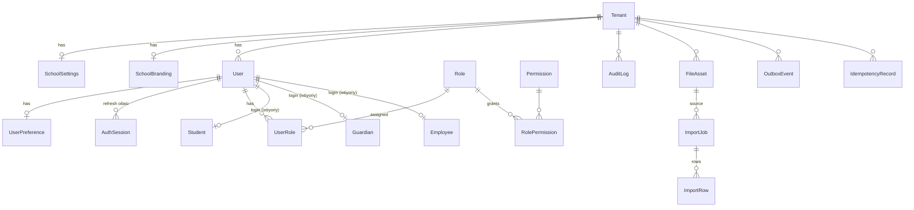
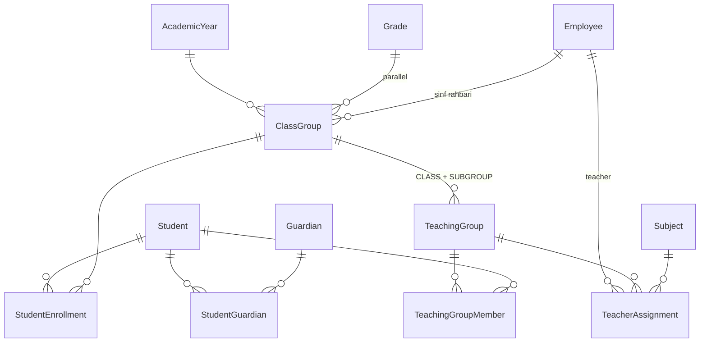
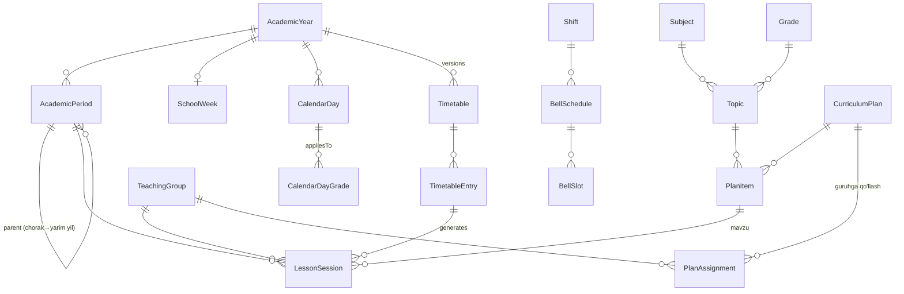
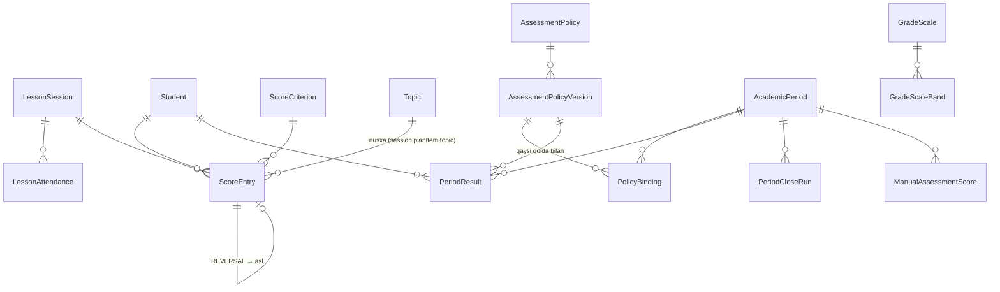
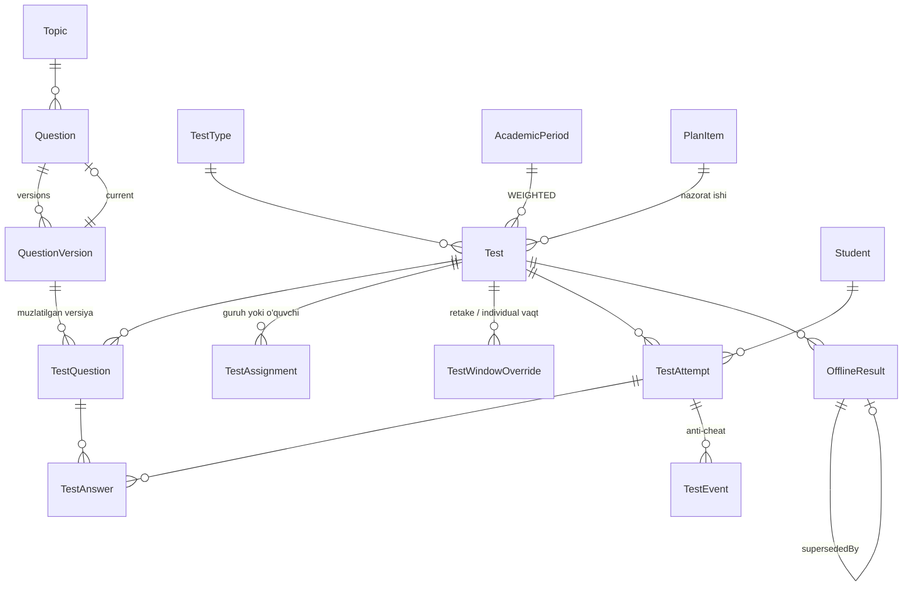
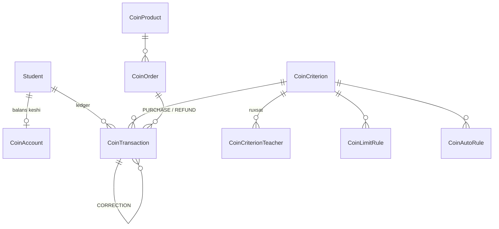

# Ma'lumotlar modeli (M1–M5)

> To'liq qoralama: `docs/architecture/schema.draft.prisma` (76 model, 58 enum; `prisma format` va `prisma validate` dan o'tgan — `prisma@6.16.2`). Migratsiya yaratilmagan.
> Manba spec'lar: `docs/spec/lesson-plan.md` (M2), `scoring.md` (M3), `tests.md` (M4), `ROADMAP.md` (M1, M5), `MASTER_SPEC.md` §7.
> Spec'dan chetga chiqishlar §7 da, ochiq masalalar `open-questions.md`da.

## 1. Konvensiyalar

| Qoida | Qiymat | Sabab |
|---|---|---|
| ID | `String @db.Uuid`, `uuid()` | Tenant'lar orasida taxmin qilinmaydi; klient (mobil, offline) oldindan ID/idempotency kaliti yarata oladi |
| Tenant | `tenantId` + FK `Tenant` (Restrict), unique indekslar tenant ichida | `architecture.md` §5 |
| Vaqt nuqtasi | `@db.Timestamptz(3)`, UTC | `CLAUDE.md` §4 |
| Maktab kuni | `@db.Date` (`date`, `schoolDate`, `validFrom/To`, `startDate/endDate`) | TZ'siz kalendar kuni; `packages/shared/time` |
| Kun ichidagi vaqt | `startMinute/endMinute Int` (Toshkent devor soati, daqiqa) | `time` tipining TZ chalkashligidan qochish |
| Ball, foiz, vazn | `Decimal` (`(8,2)` ball, `(7,4)` foiz, `(6,3)` vazn) | `Float` taqiqlangan |
| Coin | `Int` | butun birlik |
| O'chirish | FK default `Restrict`; akademik obyektlar `archivedAt`/`status`; ledger — hech qachon | `CLAUDE.md` §4 "Ledger va tarix" |
| Audit | Muhim o'zgarish `AuditLog`ga shu transaction'da | |
| Nom | Modellar va maydonlar inglizcha, enum qiymatlari `UPPER_SNAKE` | `CLAUDE.md` §5 |

`onDelete: Cascade` faqat "ota bilan birga yashaydigan" texnik bolalarda: `UserPreference`, `AuthSession`, `RolePermission`, `ImportRow`, `BellSlot`, `GradeScaleBand`, `CalendarDayGrade`, `CoinCriterionTeacher`, DRAFT `TimetableEntry`. Biznes ma'lumotlari hech qachon kaskad bilan o'chmaydi.

## 2. Domenlar bo'yicha ER diagrammalar

### 2.1. Tenant, identity, RBAC, infratuzilma (M1)

### 2.2. O'quv tuzilmasi (M1)

### 2.3. Kalendar, jadval, darslar, KTR (M2)

### 2.4. Ball engine va davriy baholash (M3)

### 2.5. Test tizimi (M4)

### 2.6. Coin (M5)

## 3. Modellar — M1

| Model | Maqsad | Asosiy maydonlar | Munosabatlar | Unique / indeks → qaysi so'rov | O'chirish |
|---|---|---|---|---|---|
| `Tenant` | Maktab | `slug`, `name`, `status` | hammasi | `slug` unique → login sahifasi (keyin subdomen) | yo'q (SUSPENDED) |
| `SchoolSettings` | Umumiy sozlamalar | `timezone`, `defaultLocale`, `enabledLocales`, `weekStartsOn`, `planApprovalRequired`, `maxQuestionsPerTest` | 1:1 Tenant | `tenantId` unique | yangilanadi (audit) |
| `SchoolBranding` | Runtime CSS variables | `schoolName`, `platformName`, `primary*Color`, `logoAssetId`, `defaultThemeMode` | FileAsset | `tenantId` unique → `GET /branding` (ochiq, kesh) | yangilanadi (audit) |
| `User` | Login identifikatori | `username`, `phone`, `passwordHash` (argon2id), `mustChangePassword`, `status` | Student/Guardian/Employee (1:1, ixtiyoriy), UserRole, AuthSession | `(tenantId, username)` unique → login; `(tenantId, phone)` → vasiyni topish | `DISABLED` |
| `UserPreference` | Tema, sidebar, density, til | | 1:1 User | PK userId | Cascade |
| `AuthSession` | Refresh oilasi | `refreshTokenHash`, `previousTokenHash`, `expiresAt`, `revokedAt`, `clientType` | User | hash'lar unique → refresh; `(tenantId, userId, revokedAt)` → "faol sessiyalarim" | revoke; muddati o'tganlar cleanup job bilan o'chiriladi (biznes ma'lumot emas) |
| `Permission` | Kodlar katalogi (global) | `code`, `module` | RolePermission | PK code | `deprecated` (seed) |
| `Role` | Rol (tizim yoki maktab) | `code`, `name`, `isSystem` | RolePermission, UserRole | `(tenantId, code)` | `archivedAt` |
| `RolePermission` | Rol → ruxsat | | | PK (roleId, code) | Cascade (rol bilan) |
| `UserRole` | Foydalanuvchi → rol | `assignedAt`, `revokedAt` | | `(tenantId, userId)` → permission yuklash; SQL partial unique faol juftlik | `revokedAt` |
| `AuditLog` | Append-only audit | `action`, `entityType`, `entityId`, `before`, `after`, `reason`, `requestId` | | `(tenantId, entityType, entityId)` → obyekt tarixi; `(tenantId, createdAt)`; `(tenantId, actorUserId, createdAt)` | hech qachon |
| `FileAsset` | Fayl metadata | `storageKey`, `mimeType`, `sizeBytes`, `sha256`, `kind`, `status` | ko'p joydan | `storageKey` unique; `(tenantId, kind, createdAt)` | `deletedAt` + storage'dan o'chirish job |
| `ImportJob` / `ImportRow` | Excel import preview → commit | `kind`, `status`, `summary`; qator: `rowNumber`, `status`, `data`, `messages` | FileAsset | `(importJobId, rowNumber)` unique | saqlanadi (audit izi) |
| `IdempotencyRecord` | `Idempotency-Key` natijalari | `key`, `requestHash`, `statusCode`, `responseBody`, `expiresAt` | | `(tenantId, userId, key)` unique; `expiresAt` → cleanup | TTL (cleanup) |
| `OutboxEvent` | Transactional outbox | `type`, `aggregate*`, `payload`, `status`, `attempts` | | `(status, availableAt)` → relay | PUBLISHED lar 30 kundan keyin tozalanadi |
| `AcademicYear` | O'quv yili | `name`, `startDate`, `endDate` (ikkalasi kiradi), `status` | ClassGroup, Period, ... | `(tenantId, name)`; SQL: bitta ACTIVE | `ARCHIVED` |
| `Grade` | Parallel (yildan mustaqil) | `level`, `name` | ClassGroup, Topic, CurriculumPlan, Question, Test | `(tenantId, level)` | `archivedAt` |
| `ClassGroup` | Yil ichidagi sinf (7-A) | `section`, `name`, `shiftId`, `homeroomTeacherId` | AcademicYear, Grade | `(tenantId, academicYearId, name)`; `(tenantId, academicYearId, gradeId)` → parallel sinflari | `archivedAt` |
| `TeachingGroup` | Dars birligi (sinf yoki guruhcha) | `kind`, `name`, `subjectId?` | ClassGroup, members, assignments, sessions | `(tenantId, academicYearId)`; SQL: har ClassGroup uchun bitta CLASS | `archivedAt` |
| `TeachingGroupMember` | A'zolik tarixi | `validFrom`, `validTo` | | `(teachingGroupId, validFrom)` → "sanadagi ro'yxat"; SQL EXCLUDE kesishmaslik | `validTo` bilan yopiladi |
| `Subject` | Fan (maktab darajasida) | `name`, `shortName`, `colorKey` | | `(tenantId, name)` | `archivedAt` |
| `Employee` | Xodim (minimal) | `firstName`, `lastName`, `positionTitle`, `status`, `employeeCode` | User?, TeacherAssignment | `(tenantId, employeeCode)`; ism bo'yicha qidiruv | `LEFT` |
| `TeacherAssignment` | O'qituvchi × guruh × fan × davr | `weeklyHours`, `validFrom`, `validTo` | | `(tenantId, teacherId, academicYearId)` → "mening guruhlarim" va ruxsat; `(tenantId, teachingGroupId, subjectId)` → "bu darsni kim o'qitadi" | `validTo` |
| `Student` | O'quvchi profili | `studentCode`, ism, `dateOfBirth`, `status`, `*Enc` sezgir maydonlar, `photoAssetId` | Enrollment, Guardians, ... | `(tenantId, studentCode)`; ism bo'yicha | `status` (LEFT/GRADUATED) |
| `Guardian` | Vasiy | ism, `phone` (E.164) | StudentGuardian | `(tenantId, phone)` → import'da moslash, M7 da Telegram bog'lash | o'chirilmaydi |
| `StudentGuardian` | m:n + huquqlar | `relation`, `isPrimary`, `canViewData`, `receivesNotifications`, `revokedAt` | | `(studentId, guardianId)`; `(tenantId, guardianId)` → "farzandlarim" | `revokedAt` |
| `StudentEnrollment` | Yil ichidagi sinf (manba) | `status`, `validFrom`, `validTo`, `reason` | | `(tenantId, classGroupId, status)` → sinf ro'yxati; SQL: bitta ACTIVE per (student, year) | tarix saqlanadi |

## 4. Modellar — M2

| Model | Maqsad | Asosiy maydonlar | Unique / indeks → so'rov | O'chirish |
|---|---|---|---|---|
| `AcademicPeriod` | Chorak / yarim yil / yil / custom | `type`, `order`, `startDate`, `endDate`, `parentId`, `status` | `(academicYearId, type, order)`; SQL EXCLUDE sanalar kesishmasin (bir xil type) | CLOSED; o'chirilmaydi |
| `SchoolWeek` | Ish kunlari | `workingWeekdays Int[]` | `academicYearId` unique | yangilanadi (audit, generatsiya diff) |
| `CalendarDay` (+`CalendarDayGrade`) | Bayram, ta'til, almashtirilgan ish kuni | `date`, `kind`, `followsWeekday`, `appliesToAll` | `(academicYearId, date)` | o'chirish mumkin, lekin faqat "diff → tasdiq" orqali (audit) |
| `Shift` | Smena | `startMinute`, `endMinute` | | `archivedAt` |
| `BellSchedule` / `BellSlot` | Qo'ng'iroq jadvali | `validFrom/To`; slot: `lessonNumber`, `startMinute`, `endMinute` | `(academicYearId, shiftId, validFrom)`; `(bellScheduleId, lessonNumber)` | yangi versiya (`validFrom`) |
| `Room` | Xona | `name`, `capacity` | `(tenantId, name)` | `archivedAt` |
| `Timetable` | Jadval versiyasi | `version`, `status`, `validFrom`, `validTo` | `(academicYearId, version)` | PUBLISHED o'zgarmaydi → ARCHIVED |
| `TimetableEntry` | Haftalik dars | `weekday`, `lessonNumber`, `weekType`, `teacherId`, `roomId` | `(timetableId, teachingGroupId)` → sinf ko'rinishi; `(timetableId, teacherId, weekday, lessonNumber)` → o'qituvchi to'qnashuvi | faqat DRAFT ichida |
| `LessonSession` | Aniq dars (schoolDate) | `date`, `lessonNumber`, `startsAt`, `endsAt`, `sequenceNo`, `status`, `source`, `planItemId`, `actualTopicNote` | `(teachingGroupId, date, lessonNumber)` unique → idempotent generatsiya; `(tenantId, teacherId, date)` → "bugungi darslarim"; `(teachingGroupId, subjectId, sequenceNo)` → mavzu joylash; `(periodId, teachingGroupId, subjectId)` → jurnal | HELD/ball bog'langan — hech qachon; SCHEDULED kelajakdagi — CANCELLED (o'chirilmaydi) |
| `Topic` | Mavzu (ball, savol, AI uchun) | `title`, `normalizedTitle`, `parentTopicId` | `(tenantId, subjectId, gradeId, normalizedTitle)` → import moslash | `archivedAt` |
| `CurriculumPlan` | KTR shabloni (versiyalangan) | `lineageId`, `version`, `status`, `approvedById` | `(lineageId, version)`; `(tenantId, academicYearId, subjectId, gradeId)` | APPROVED o'zgarmaydi → yangi versiya; ARCHIVED |
| `PlanItem` | Reja qatori | `order`, `topicId`, `hours`, `lessonType`, `periodId` | `(planId, order)` | reja versiyasi bilan muzlaydi |
| `PlanAssignment` | Shablonni guruhga qo'llash | `status`, `appliedAt` | SQL: (teachingGroupId, subjectId) bo'yicha bitta ACTIVE | SUPERSEDED |

## 5. Modellar — M3

| Model | Maqsad | Asosiy maydonlar | Unique / indeks → so'rov | O'chirish |
|---|---|---|---|---|
| `ScoreCriterion` | Ball mezoni | `name`, `isActive`, `order` | | `isActive=false` |
| `LessonAttendance` | Dars davomati (joriy holat) | `status`, `markedById`, `markedAt` | `(lessonSessionId, studentId)` unique → jurnal; tarix AuditLog'da | o'zgartiriladi (audit bilan) |
| `ScoreEntry` | **Ledger**: kunlik ball | `schoolDate` (= sessiya sanasi), `points`, `kind`, `reversesEntryId`, `reason`, `idempotencyKey`, `topicId` | `(tenantId, idempotencyKey)` → takror so'rov; `(tenantId, studentId, schoolDate)` → kunlik/haftalik/oylik limit va progress; `(tenantId, studentId, subjectId, schoolDate)` → fan limiti; `(lessonSessionId, studentId)` → sessiya limiti, jurnal; `(periodId, subjectId, studentId)` → davr natijasi; `(teacherId, schoolDate)` → TEACHER limiti, "kim ball qo'ymagan"; `reversesEntryId` unique → bir marta reverse | **hech qachon** (trigger) |
| `ScoreLimitRule` | Limit qoidasi | `window`, `scopeType`, scope ustunlari, `maxPoints` | `(tenantId, window, scopeType, isActive)`; SQL partial unique faol qoida | `isActive=false` |
| `ScoreSettings` | Hard cap'lar, default max, lateEntryDays | | `tenantId` unique | yangilanadi (audit) |
| `AssessmentPolicy` / `AssessmentPolicyVersion` | Baholash qoidasi (versiyalangan) | `config` (zod), `configHash`, `status` | `(policyId, version)`; SQL: bitta default policy | PUBLISHED o'zgarmaydi → RETIRED |
| `PolicyBinding` | Davr (+fan) → policy versiyasi | `boundAt`, `supersededAt`, `reason` | SQL partial unique faol bog'lanish | `supersededAt` |
| `GradeScale` / `GradeScaleBand` | 5 ballik shkala | `minPercent`, `maxPercent`, `label` | `(scaleId, order)` | `isActive=false` |
| `ManualAssessmentScore` | MANUAL komponent kirishi (yangi) | `componentKey`, `points`, `maxPoints`, `supersededById` | SQL partial unique joriy qiymat | yangi qator + supersededBy |
| `PeriodResult` | Davr natijasi (snapshot) | `status`, `version`, `isCurrent`, `isComplete`, `isStale`, `components`, `percent`, `displayPercent`, `gradeLabel`, `inputsHash`, `policyVersionId` | SQL partial unique `isCurrent`; `(tenantId, periodId, subjectId)` → sinf natijalari; `(studentId, periodId)` → o'quvchi kartasi | FINAL — hech qachon; qayta hisob = yangi `version` |
| `PeriodCloseRun` | "Yopishga tayyorlash" hisoboti | `report`, `status` | `(periodId)` | saqlanadi |

## 6. Modellar — M4, M5

| Model | Maqsad | Asosiy maydonlar | Unique / indeks → so'rov | O'chirish |
|---|---|---|---|---|
| `TestType` | ChSB, BSB, ... + maxsus | `code`, `isSystem` | `(tenantId, code)` | `isActive=false` |
| `Question` | Savol (bank) | `ownerId`, `subjectId`, `gradeId`, `topicId`, `type`, `difficulty`, `sharedWithSubject`, `currentVersionId` | `(tenantId, ownerId, subjectId)` → mening bankim; `(tenantId, subjectId, gradeId, topicId)` → pool tanlash, "mavzusiz" filtr | `ARCHIVED` |
| `QuestionVersion` | Muzlatilgan mazmun | `text`, `options` (barqaror option id), `acceptedAnswers`, `pairs`, `points`, `contentHash` | `(questionId, version)`; `contentHash` → dublikat | hech qachon (testda ishlatilgan bo'lishi mumkin) |
| `Test` | Test (online/offline × practice/weighted) | `format`, `purpose`, `status`, vaqtlar, `selection`, `maxScore`, `periodId`, `weight`, `includedInAssessment`, `retakePolicy`, `violationThreshold`, `showResultToStudent`, `multipleScoring` | `(tenantId, subjectId, gradeId, status)`; `(tenantId, teacherId, createdAt)`; `(periodId)` → davr testlari | `ARCHIVED` (natijasi bor test o'chirilmaydi) |
| `TestQuestion` | Testdagi savol versiyasi | `order`, `points` | `(testId, questionVersionId)`, `(testId, order)`; "bu sinfga avval berilgan" — `TestQuestion → Test → TestAssignment` orqali | DRAFT testda o'zgaradi |
| `TestAssignment` | Kimga berilgan | `teachingGroupId` yoki `studentId` (SQL CHECK: aynan bittasi) | `(testId, teachingGroupId)`, `(testId, studentId)` | DRAFT'da |
| `TestWindowOverride` | Retake / individual vaqt | `startsAt`, `endsAt`, `timeLimitMinutes`, `reason` | `(testId, studentId)` | `cancelledAt` |
| `TestAttempt` | Server-side sessiya | `attemptNo`, `deadline`, `questionOrder`, `optionOrder`, `currentIndex`, `violationCount`, `status`, `finishReason`, `score`, `percent` | `(testId, studentId, attemptNo)`; SQL: bitta IN_PROGRESS; `(status, deadline)` → lazy/sweeper finalize | hech qachon |
| `TestAnswer` | Javob (upsert, clientSeq) | `answer` (option id'lar), `clientSeq`, `savedAt`, `isCorrect`, `pointsAwarded` | `(attemptId, testQuestionId)` | attempt bilan |
| `TestEvent` | Anti-cheat hodisalari | `type`, `clientTs`, `serverTs`, `counted`, `clientEventId` | `(attemptId, clientEventId)` → qayta yuborish dedupe; `(attemptId, type, serverTs)` → 2 s dedupe | hech qachon |
| `OfflineResult` | Qog'oz test natijasi | `rawScore`, `status`, `supersededById` | SQL partial unique joriy natija | yangi qator + supersededBy |
| `CoinSettings` | Coin kalitlari, qarz, faollik | | `tenantId` unique | yangilanadi (audit) |
| `CoinCriterion` (+`CoinCriterionTeacher`) | Mezon va o'qituvchi ruxsati | `type`, `minAmount`, `maxAmount`, `subjectId`, `eligibility`, `isAutomatic` | | `isActive=false` (tranzaksiyasi bor mezon o'chirilmaydi) |
| `CoinLimitRule` | Limit (EdexTest modeli) | `scope`, `period`, `type`, `maxAmount`, `maxCount`, `durationMinutes`, `countTypesSeparately` | `(tenantId, isActive)` | `isActive=false` |
| `CoinAccount` | Balans keshi + lock nuqtasi | `balance` | `studentId` unique | hech qachon |
| `CoinTransaction` | **Ledger** | `type`, `source`, `amount`, `balanceAfter`, `schoolDate`, `academicYearId`, `reversesTransactionId`, `correctsTransactionId`, `sourceRef`, `idempotencyKey` | `(tenantId, idempotencyKey)`; `(tenantId, source, sourceRef)` → avtomatik coin takrorlanmaydi; `(tenantId, studentId, schoolDate)` → limit va tarix; `(tenantId, teacherId, schoolDate)` → faollik; `(tenantId, type, schoolDate)` → dashboard | **hech qachon** (trigger) |
| `CoinProduct` | Do'kon mahsuloti | `price`, `stock`, `isVisible` | | `archivedAt` |
| `CoinOrder` | Buyurtma | `status`, `priceAtOrder`, `productNameSnapshot`, `idempotencyKey` | `(tenantId, status, createdAt)` → admin navbati; `(studentId, createdAt)` | status bilan yopiladi |
| `CoinAutoRule` | Avtomatik coin qoidasi | `source`, `criterionId`, `config` | | `isActive=false` |

## 7. Spec'dan chetga chiqishlar va qo'shimchalar

| # | Spec | Qoralamada | Sabab |
|---|---|---|---|
| 1 | `AcademicPeriod.type` = QUARTER\|HALF\|CUSTOM | `YEAR` qo'shildi, `parentId` ierarxiyasi | scoring §5.4 "yillik" natija; yuqori davr agregatsiyasi uchun daraxt (Q-11) |
| 2 | `ScoreLimitRule.scopeId?` (polimorf) | `subjectId`/`gradeId`/`teacherId`/`teachingGroupId` alohida ustunlar + CHECK | FK yaxlitligi; ma'nosi o'zgarmaydi |
| 3 | MANUAL komponent kiritish modeli yo'q | `ManualAssessmentScore` | scoring §5.1 (Q-12) |
| 4 | `period.maxPoints` (scoring §5.1 validatsiya) | Davrda maydon yo'q; `config.periodMaxPoints` ishlatiladi | §6 config bilan ziddiyat (Q-14) |
| 5 | `Test.multipleScoring` modelda yo'q | qo'shildi (default ALL_OR_NOTHING) | tests §4.6 (Q-19) |
| 6 | `PeriodResult` | `isCurrent`, `isComplete`, `isStale`, `displayPercent` qo'shildi | "eskirgan" belgisi (scoring §7.3), `PENDING` holati (§5.3), yaxlitlash faqat ko'rsatishda (§5.6) |
| 7 | — | `PeriodCloseRun` | §7.1 to'liqmaslik hisobotini saqlash va tasdiqlash |
| 8 | `TestEvent` | `clientEventId` qo'shildi | tarmoq qayta yuborishida dublikat sanalmasligi |
| 9 | `TestAttempt` | `windowOverrideId`, `reopenCount`, `lastReopenedAt` | §4.4 qayta ochish, §5 retake |
| 10 | `Test` | `takenOn` (OFFLINE sanasi), `revealCorrectAnswers` | offline testning schoolDate'i; to'g'ri javoblarni ko'rsatish siyosati (Q-21) |
| 11 | `CurriculumPlan.version` | `lineageId` qo'shildi | bir rejaning versiyalarini guruhlash |
| 12 | `PlanAssignment` | `subjectId` (nusxa) | "guruh+fan uchun bitta faol reja" partial unique |
| 13 | `LessonSession` | `cancelReason` | bekor qilish auditi va UI |
| 14 | `Subject` gradeId'siz | EdexTest'da fan sinfga bog'langan edi | fan maktab darajasida, parallel — Topic/Plan/Question'da |
| 15 | `CoinTransaction` | `schoolDate`, `source`, `sourceRef`, `CoinAccount` | limitlar schoolDate bo'yicha; avtomatik coin idempotentligi; lock nuqtasi |
| 16 | Teacher ID | barcha `teacherId` → `Employee` (User emas) | o'qituvchi — xodim; login ixtiyoriy. Kim yozgani `createdById`/`actorUserId` (User) |

## 8. SQL-only invariantlar (Prisma ifodalay olmaydi)

Migratsiya SQL'ida yoziladi, `packages/db/INVARIANTS.md`da ro'yxatlanadi, integration test har migratsiyadan keyin `pg_indexes`/`pg_constraint`/`pg_trigger` orqali mavjudligini tekshiradi (EdexTest `ACADEMIC_YEAR_INVARIANTS.md` usuli).

| Obyekt | Tur | Qoida |
|---|---|---|
| `AcademicYear_one_active` | partial unique | `(tenantId) WHERE status='ACTIVE'` |
| `AcademicYear_dates_check` | CHECK | `startDate <= endDate` |
| `UserRole_active_unique` | partial unique | `(userId, roleId) WHERE revokedAt IS NULL` |
| `TeachingGroup_one_class_group` | partial unique | `(classGroupId) WHERE kind='CLASS'` |
| `TeachingGroupMember_no_overlap` | EXCLUDE (btree_gist) | bir guruhda bir o'quvchining oraliqlari kesishmaydi |
| `StudentEnrollment_one_active` | partial unique | `(studentId, academicYearId) WHERE status='ACTIVE'` |
| `AcademicPeriod_no_overlap` | EXCLUDE | bir yil, bir `type` ichida sanalar kesishmaydi |
| `PlanItem_hours_check` | CHECK | `hours >= 1` |
| `PlanAssignment_one_active` | partial unique | `(teachingGroupId, subjectId) WHERE status='ACTIVE'` |
| `ScoreEntry_points_sign` | CHECK | `kind='NORMAL' ⇒ points > 0`, `kind='REVERSAL' ⇒ points < 0 AND reason IS NOT NULL AND reversesEntryId IS NOT NULL` |
| `ScoreEntry_append_only` | TRIGGER | `BEFORE UPDATE OR DELETE` → exception |
| `ScoreLimitRule_scope_check` | CHECK | `scopeType` ga mos ustun(lar)gina to'ldirilgan |
| `ScoreLimitRule_active_unique` | partial unique | `(tenantId, window, scopeType, COALESCE(scope ustuni)) WHERE isActive` |
| `AssessmentPolicy_one_default` | partial unique | `(tenantId) WHERE isDefault` |
| `AssessmentPolicyVersion_published_immutable` | TRIGGER | `status='PUBLISHED'` qatorda `config` o'zgarmaydi |
| `PolicyBinding_active_unique` | partial unique | `(periodId, COALESCE(subjectId, nil-uuid)) WHERE supersededAt IS NULL` |
| `PeriodResult_current_unique` | partial unique | `(studentId, periodId, COALESCE(subjectId, nil-uuid)) WHERE isCurrent` |
| `PeriodResult_final_immutable` | TRIGGER | `status='FINAL'` qatorda faqat `isCurrent`, `isStale` o'zgarishi mumkin |
| `ManualAssessmentScore_current_unique` | partial unique | `(periodId, subjectId, studentId, componentKey) WHERE supersededById IS NULL` |
| `Test_weighted_check` | CHECK | `purpose='WEIGHTED' ⇒ periodId IS NOT NULL AND weight > 0` |
| `Test_offline_scale_check` | CHECK | `format='OFFLINE' ⇒ maxScore IN (5,10,20,25,40,50,100)` |
| `TestAssignment_target_check` | CHECK | `(teachingGroupId IS NULL) <> (studentId IS NULL)` |
| `TestAttempt_one_in_progress` | partial unique | `(testId, studentId) WHERE status='IN_PROGRESS'` |
| `OfflineResult_current_unique` | partial unique | `(testId, studentId) WHERE supersededById IS NULL` |
| `OfflineResult_score_check` | CHECK | `status='SCORED' ⇔ rawScore IS NOT NULL` |
| `CoinLimitRule_bound_check` | CHECK | `maxAmount IS NOT NULL OR maxCount IS NOT NULL` |
| `CoinTransaction_append_only` | TRIGGER | `BEFORE UPDATE OR DELETE` → exception |
| `AuditLog_append_only` | TRIGGER | `BEFORE UPDATE OR DELETE` → exception |
| `SchoolBranding_color_check` | CHECK | rang maydonlari `^#[0-9A-Fa-f]{6}$` |

## 9. Concurrency kalitlari

| Amal | Lock | Kalit |
|---|---|---|
| Ball yozish / reverse | **Tavsiya:** `pg_advisory_xact_lock(hashtextextended('score:'||tenantId||':'||studentId, 0))` | o'quvchi darajasi. Spec (`scoring.md` §3.1) kalitga `schoolDate`ni ham qo'shadi, lekin unda turli kunlarga (masalan kechagi darsga kechikkan ball + bugungi ball) parallel yozuvlar WEEK/MONTH/PERIOD limitini birga chetlab o'tishi mumkin. Spec'ning o'zi "bir o'quvchiga bir vaqtda faqat bitta yozish" deydi — bu o'quvchi darajasidagi kalitga mos. Q-46 |
| Coin | `SELECT ... FOR UPDATE` `CoinAccount` qatori | o'quvchi |
| Test javobi / yakunlash | `SELECT ... FOR UPDATE` `TestAttempt` | attempt |
| Davrni yopish | `pg_advisory_xact_lock('period-close:'||periodId)` | davr |
| Generatsiya | `pg_advisory_xact_lock('lessons-gen:'||academicYearId)` | yil |

## 10. Kengaytirish nuqtalari (M6+)

| Bosqich | Qo'shiladigan modellar | Hozirgi tayyorgarlik |
|---|---|---|
| M6 Face ID | `Device`, `FaceProfile`, `FaceSyncJob`, `AccessEvent`, `AttendanceRecord` (SCHOOL_ATTENDANCE), `BridgeAgent`, `BridgeJob`, `LatenessBand` | `Student.photoAssetId`, `Shift.startMinute`, `CoinAutoSource.ATTENDANCE`, `CoinTxSource.ATTENDANCE`, Outbox |
| M7 Vasiy + Telegram | `TelegramLink`, `Notification`, `NotificationTemplate`, `NotificationDelivery`, `Announcement`, `GuardianLinkCode` | `Guardian.phone` (E.164), `StudentGuardian.receivesNotifications`, `ClientType.TELEGRAM`, Outbox hodisalari |
| M8 Mobil | `PushDevice` | Bearer auth rejimi, `ClientType.MOBILE`, UUID'lar |
| Moliya | `ContractType`, `Contract`, `PaymentPlan(Item)`, `Payment`, `PaymentAllocation`, `Cashbox`, ... (pul — `BigInt`/`Int` UZS) | `SchoolSettings.currency`, ledger qoidalari |
| HR / KPI | `Position`, `EmployeeContract`, `SalaryConvention`, `Violation`, `StaffObservation` | `Employee` |
| CRM | `Lead`, `Candidate`, `TestAudience.LEAD/CANDIDATE` | `Test.audience` |
| AI feedback | `TopicMastery` (kesh), `AiFeedbackDraft` | `Topic`, `ScoreEntry.topicId`, `Question.topicId` |
| Avtomatik jadval | `TimetableDraft`, `TimetableConstraint`, `TeacherWorkload` | `Timetable` versiyalash, `Room` |
| Yil o'tishi wizard | `AcademicYearTransition`, snapshotlar (EdexTest g'oyasi) | `StudentEnrollment` tarixi |
| 2FA | `User.totpSecretEnc`, `RecoveryCode` | Auth servisi |
